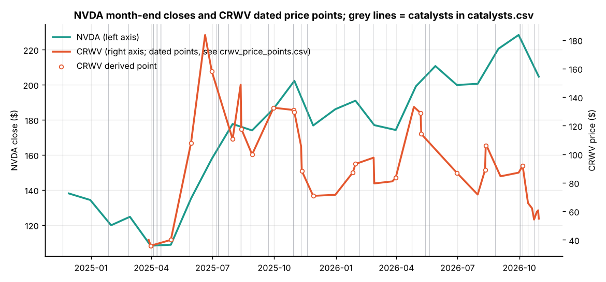
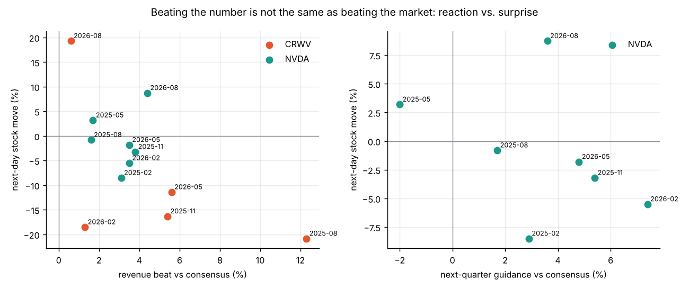
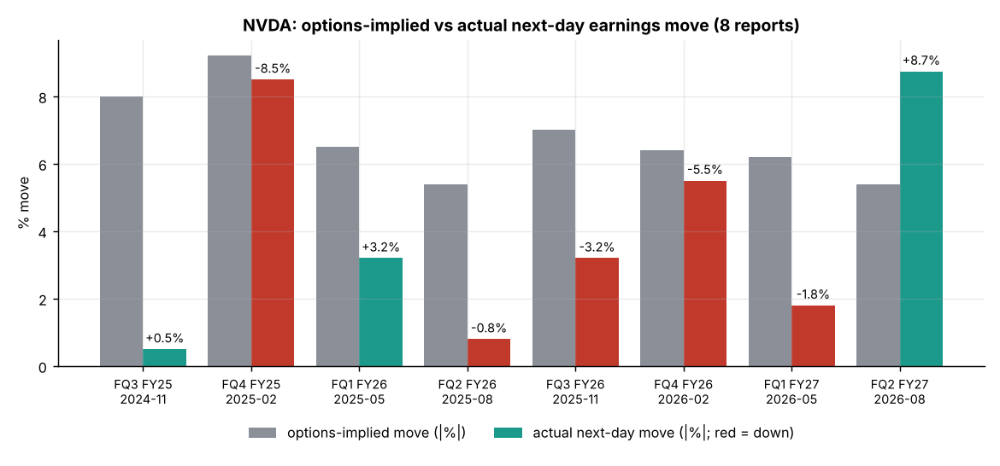
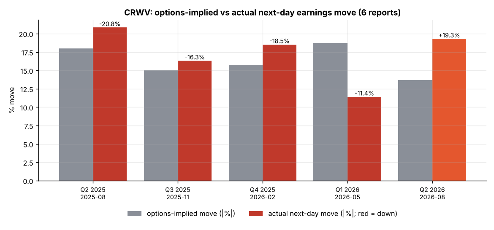
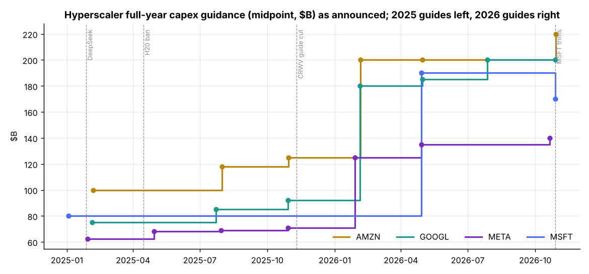
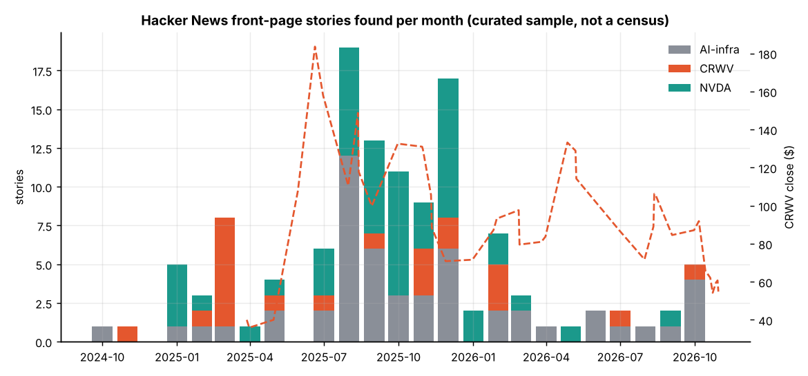

# CoreWeave and NVIDIA, November 2024 to October 2026: what the options market, the quarterly reports, Hacker News and the credit market told each other

*Study compiled 31 October 2026. Every figure cited below traces to a source URL in `../data/curated/`; values that could not be sourced are marked NA, and derived values are labelled as such. Analysis code is in `../src/optlab/` and `../scripts/`.*

## The brief, restated

You asked for a study of how CoreWeave (CRWV) and NVIDIA (NVDA) options behaved over the past two years, lined up against each company's quarterly reports and guidance, the share-price path, commentary and Hacker News attention, and any other signal worth adding. The goal is to find the correlations and the mechanism underneath them, combining fundamental and quantitative analysis, and to isolate signals that can be read early enough to trade over the next six months (November 2026 to April 2027).

## 1. Executive summary

1. **The two stocks share one macro factor but live in opposite volatility regimes.** Across eight NVDA earnings reports the options market over-priced the next-day move in seven. Across CRWV's five measurable reports it under-priced the move in four. Mean implied versus mean realised: NVDA 6.8% implied against 4.0% realised; CRWV 16.2% implied against 17.3% realised.
2. **NVDA's print is pre-telegraphed; CRWV's is not.** Hyperscaler capex guidance, supply-chain data and Nvidia's own "reset the Street" commentary leak most of the information before the report, so the straddle decays. CRWV's reports carry genuinely new information on capex, margins, delivery delays and financing, and the stock has moved 11% to 21% every time.
3. **Vol sellers in NVDA got complacent and were punished once.** Implied moves compressed from 9.2% (Feb 2025) to 5.4% (Aug 2026, "lowest in two years"), and the one quarter they fell below the trailing realised average was the one the stock moved +8.7%. Rule of thumb that falls out of the data: the premium-selling edge exists when implied is well above the 12-quarter realised average (about 7.4%), and disappears when implied is below it.
4. **Beats did not move NVDA; guidance did, and in the wrong direction.** Revenue beat size had no relationship with the reaction (Spearman +0.07). Guidance above consensus had a negative relationship (Spearman -0.55, n=8): the bigger the guide beat, the more it was already in the price. The buy-side whisper, not the sell-side consensus, is the hurdle.
5. **NVDA's day-one direction persisted.** In the five quarters with drift data, the sign of the day-one move matched the sign of the 21-day drift every time (Spearman +0.90, p=0.04). Trading the direction after the print has been more reliable than trading the print.
6. **Credit led CRWV equity.** CRWV's 5-year CDS moved from about 600bp (Nov 2025) to 452bp (Jun 2026) to over 1,140bp (mid Oct 2026). Each widening preceded or coincided with the start of an equity leg down; the Oct 2026 bond rout (yields 15 to 16%) came a week before the broad AI selloff on 30 October.
7. **Hyperscaler capex guidance is the master upstream signal.** Every 2025 raise preceded an NVDA leg up; the first trims and holds (Meta narrowed, Microsoft trimmed to $170B, Alphabet held) in late October 2026 triggered the SOX's -7.2% day and CRWV's -10% day. Late January 2027, when 2027 capex is guided, is the single most important date in the window.
8. **Hacker News was a contrarian indicator at CRWV's IPO, a crowding indicator at NVDA's milestones, and an early thematic radar on credit.** Seven duplicate "$5T" submissions landed on 29 October 2025, the record close; the stock was 14.6% lower a month later. HN threads on CoreWeave CDS and GPU residual value ran a year ahead of the distressed-yield headlines.
9. **Current setup (31 Oct 2026):** NVDA implied move for 17 Nov is 8.8% to 10.5% with IV30 at 45% (81st percentile) after the selloff, well above the 4.0% average realised move. CRWV implied for 10 Nov is quoted anywhere from 9.8% to 20% depending on source, against a 17% average realised move, with short interest of 22% to 27% of float, bonds at 15% and $6.2B of principal due in 2027.
10. **The six-month trade map** is in Section 8: sell NVDA event vol when implied is above about 7.5% and IV rank is high, buy CRWV event vol when implied is below about 15%, trade NVDA's post-print drift rather than the print, use CRWV bond yields and CDS as the stop-loss for any CRWV long, and treat the late-January 2027 capex guides and the February NVDA print as the decisive catalysts.

## 2. Data, method and honesty

Direct downloads from Yahoo Finance, Stooq, SEC EDGAR, the Hacker News Algolia API and Cboe were blocked by the sandbox's network policy. The analysis therefore rests on **curated event data** compiled from public reporting via web search by five parallel research passes, each row carrying a URL:

| File | Rows | What it holds |
|---|---|---|
| `nvda_earnings.csv` | 8 | Eight NVDA reports: results, consensus, guidance, closes, 1-day move, 5d/21d drift, options-implied move, verdict |
| `crwv_earnings.csv` | 7 | Six CRWV reports plus the upcoming one: results, backlog, margins, interest, debt, guidance, 1-day move, implied move |
| `crwv_events.csv` | 43 | IPO, contracts, debt deals, lockups, M&A, analyst actions, insider sales, index changes |
| `crwv_price_points.csv` | 42 | Dated CRWV prices; `basis` column says close / derived / approx |
| `nvda_monthly_close.csv` | 25 | NVDA month-end closes (StatMuse; appear dividend-adjusted by about $0.15) |
| `catalysts.csv` | 45 | Dated single-day catalysts for both names with moves and VIX where known |
| `options_vol_observations.csv` | 56 | IV30, IV rank, implied/realised moves, put/call, volume, skew, short interest, ETF AUM, CDS |
| `hn_stories.csv` | 124 | Hacker News stories on CoreWeave, Nvidia and AI infrastructure; dates interpolated from item IDs (±3-5 days); points NA |
| `macro_signals.csv` | 103 | Export controls, OpenAI deals, bubble narrative, credit, capex, rates; `confidence` column flags 26 memory-only rows |
| `hyperscaler_capex_guidance.csv` | 24 | Full-year capex guides as announced, Jan 2025 to Oct 2026 |
| `recent_2026_timeline.csv`, `forward_calendar.csv` | 70, 28 | May to Oct 2026 events; Nov 2026 to Apr 2027 catalysts |

Three honesty notes. First, the CRWV monthly path for 2025 is **derived** from a published table of monthly percentage changes anchored on the sourced 31 Dec 2025 close of $71.61; it reconciles with every independently sourced point (IPO $40, ATH $183.58, $148.75 before Q2 2025, $105.61 before Q3 2025) to within a few percent, but it is not exchange data. Second, options-implied moves are the pre-report straddle figures published by Bloomberg, Reuters/ORATS, ConvexValue, Optionomics, TipRanks, tastylive or Earnings Watcher at the time; where providers disagreed, the first-listed primary figure is used in the tables and the alternatives are kept in the CSV cell. Third, with eight and five events respectively, every statistic here is small-sample; the Spearman p-values are reported so you can see how thin the ice is. The pipeline in `scripts/run_pipeline.py` will replace the curated series with daily data the moment the hosts are allowed.

## 3. The price paths

NVDA went from about $138 (Nov 2024) to a record close of $238.90 on 6 Oct 2026 and $204.64 on 30 Oct 2026, through four drawdowns: -37% (Jan to Apr 2025: DeepSeek, tariffs, H20 ban), -19% (Oct 2025 to Mar 2026: the AI-bubble winter), -15% (May to Jul 2026) and -14% (6 to 30 Oct 2026). Market cap crossed $4T (Jul 2025), $5T (29 Oct 2025, again 24 Apr 2026) and approached $6T (early Oct 2026) before Apple retook the top spot on 30 Oct 2026.

CRWV priced its IPO at $40 on 27 Mar 2025 (below the $47 to $55 range, downsized, Nvidia anchoring $250M), closed flat on day one, bottomed at $33.52 on 21 Apr 2025, ran 4.6x to a $183.58 close on 20 Jun 2025, and has since made a series of lower highs: $148.75 (Aug 2025), about $133 (Sep/Oct 2025), $133.20 (Apr 2026), about $106 (Aug 2026), then a collapse to $54.87 on 30 Oct 2026, within 7% of the $51.24 low set on 26 Oct 2026. It is down about 70% from the high while NVDA is up about 50% over the same span. The pair share direction on macro days (DeepSeek, April 2025 tariffs, the Oct 2026 AI scare) but CRWV's biggest moves were idiosyncratic: earnings, lockups, financing and credit.

## 4. The quarterly reports, scored

### 4.1 NVIDIA: eight reports

| Report | Quarter | Revenue $B | Beat % | Guide vs cons % | Implied % | Actual % | 5d drift % | 21d drift % |
|---|---|---|---|---|---|---|---|---|
| 2024-11-20 | FQ3 FY25 | 35.1 | NA | +1.1 | 8.0 | +0.5 | NA | NA |
| 2025-02-26 | FQ4 FY25 | 39.3 | +3.1 | +2.9 | 9.2 | -8.5 | -10.6 | -15.1 |
| 2025-05-28 | FQ1 FY26 | 44.1 | +1.7 | -2.0 | 6.5 | +3.2 | +5.3 | +17.0 |
| 2025-08-27 | FQ2 FY26 | 46.7 | +1.6 | +1.7 | 5.4 | -0.8 | -5.5 | -1.9 |
| 2025-11-19 | FQ3 FY26 | 57.0 | +3.8 | +5.4 | 7.0 | -3.2 | -3.4 | -1.5 |
| 2026-02-25 | FQ4 FY26 | 68.1 | +3.5 | +7.4 | 6.4 | -5.5 | -6.4 | -12.4 |
| 2026-05-20 | FQ1 FY27 | 81.6 | +3.5 | +4.8 | 6.2 | -1.8 | NA | NA |
| 2026-08-26 | FQ2 FY27 | 96.2 | +4.4 | +3.6 | 5.4 | +8.7 | NA | NA |

Revenue nearly tripled, data-centre revenue went from $30.8B to $89.0B, every quarter beat consensus and every quarter but one guided above it, yet the stock fell on six of eight reaction days. The one below-consensus guide (May 2025, when the H20 export ban removed $8B of China revenue) produced a rally, because the bar had already been cut. Non-GAAP gross margin held at 72% to 75% except for the H20 write-down quarter, and the Q3 FY27 guide takes it down to 74% on memory costs, the first margin headwind that is not policy-driven.

The sell-side read the pattern in real time: Motley Fool counted declines after six of the eight prior reports; CNBC wrote before the Feb 2026 print that Nvidia "would have had to beat all expectations by a long way in order to see a pop"; Yahoo Finance described management's $500B visibility commentary as Nvidia trying to "reset" Street estimates upward. Jensen Huang's "Blackwell sales are off the charts, and cloud GPUs are sold out" (Nov 2025) coincided with a -3.2% day.

### 4.2 CoreWeave: six reports

| Report | Quarter | Revenue $M | Beat % | Backlog $B | Adj. EBITDA margin % | Interest $M | Implied % | Actual % |
|---|---|---|---|---|---|---|---|---|
| 2025-05-14 | Q1 2025 | 982 | beat | 25.9 | 62 | 264 | NA | about -2 (fell after hours on capex guide) |
| 2025-08-12 | Q2 2025 | 1,213 | +12.3 | 30.1 | 62 | 267 | 18.0 | -20.8 |
| 2025-11-10 | Q3 2025 | 1,360 | +5.4 | 55.6 | 61 | 311 | 15.0 | -16.3 |
| 2026-02-26 | Q4 2025 | 1,570 | +1.3 | 66.8 | 57 | 388 | 15.7 | -18.5 |
| 2026-05-07 | Q1 2026 | 2,080 | +5.6 | 99.4 | 56 | 536 | 18.7 | -11.4 |
| 2026-08-11 | Q2 2026 | 2,575 | +0.6 | 104.2 | 59 | 640 | 13.7 | +19.3 |

Revenue grew 2.6x in five quarters and backlog 4x, yet the stock fell after the first five reports. The drivers were never the top line. They were: wider-than-expected losses; capex guidance repeatedly raised above the Street (FY25 $20 to 23B; FY26 $30 to 35B, then $31 to 35B, then $35 to 39B); soft next-quarter guides (Q1 2026 guided $1.9 to 2.0B against $2.29B consensus; Q2 2026 guided $2.45 to 2.6B against $2.69B); margin compression as adjusted EBITDA margin slid from 62% to 56% and the quarterly interest bill rose from $264M to $640M; and, in Nov 2025, an outright cut to FY25 revenue and capex because "there were delays at the facility" of a third-party data-centre developer, in Michael Intrator's words. The one positive reaction, +19.3% in Aug 2026, was the first clean beat-and-raise with a Q3 guide above consensus, into 15.8% short interest and bearish options skew: a squeeze.

The scatter makes the point visually: for both names, the size of the revenue beat tells you nothing about the direction of the reaction. For NVDA, the guidance panel slopes the wrong way.

## 5. What the options market priced, and what happened

### 5.1 NVDA: a variance risk premium that got arbitraged, then snapped

| Statistic (8 reports) | Value |
|---|---|
| Reports where actual exceeded implied | 1 of 8 (12%) |
| Mean implied move | 6.8% |
| Mean absolute realised move | 4.0% |
| Median realised/implied | 0.47 |
| First-order straddle P&L as % of premium | -39% |

The finding is consistent with the academic literature. Dubinsky and Johannes (2006) and Dubinsky, Johannes, Kaeck and Seeger (Review of Financial Studies, 2019) model earnings as known-timing jumps and find that the option-implied jump volatility is generally above what is subsequently realised. Barth and So (Accounting Review, 2014) show the premium is concentrated in "bellwether" firms whose announcements carry non-diversifiable, market-wide information. NVDA is the bellwether of the entire AI trade, so a large and persistent premium is expected. ORATS noted at one point that NVDA had moved less than implied for eight straight reports; Optionomics' seven-quarter window shows 6.97% implied against 4.15% realised.

What is more interesting is the dynamics. The implied move compressed from 9.2% to 5.4% over six quarters as sellers crowded into a trade that kept working, and dollar headlines ("largest-ever $320B swing") masked the fact that percentage vol expectations were at two-year lows. SpotGamma warned before the Feb 2026 print that "the options market may be underpricing this move"; Susquehanna noted in May 2026 that the weekly straddle at 6.5% was below the 8% average of the prior ten reports. In Aug 2026, with implied at 5.4% against a 7.4% twelve-quarter realised average, the stock moved +8.7% and added over $400B in a day. The signal is the ratio of implied to trailing realised, not the level of implied.

Two structural features explain why NVDA's premium is both large and fragile. Positioning is call-heavy: calls traded about twice puts into the May 2026 print, SpotGamma put call skew at the 81st percentile against put skew at the 16th, and the volume put/call ratio sat near 0.58 even in the Oct 2026 drawdown. Call-heavy positioning plus post-print IV crush produces the "beat and fall" pattern mechanically, as dealers unwind long delta. NVDA and TSLA each account for roughly 9% of US single-stock option volume, and 2025 was a record 15.2B contracts, so the marginal buyer of NVDA calls is retail and the marginal seller of vol is systematic. That combination makes the premium reliable in calm regimes and prone to a one-off failure when the crowd has compressed it too far.

Post-print drift adds a second edge. In the five quarters with 5-day and 21-day data, the day-one sign matched the 21-day sign every time (Feb 2025: -8.5% then -15.1%; May 2025: +3.2% then +17.0%; Feb 2026: -5.5% then -12.4%). Spearman +0.90 with n=5 is a hint rather than proof, but it is consistent with the market-wide post-earnings drift literature and with the observation that NVDA's post-print direction tracked the macro tape (Nov 2025: S&P -1.6%, VIX 26; Feb 2026: Nasdaq -1.3%) rather than the print itself.

### 5.2 CRWV: the market kept under-pricing jump risk

| Statistic (5 reports with implied data) | Value |
|---|---|
| Reports where actual exceeded implied | 4 of 5 (80%) |
| Mean implied move | 16.2% |
| Mean absolute realised move | 17.3% |
| Median realised/implied | 1.16 |
| First-order straddle P&L as % of premium | +9% |

Earnings Watcher's own tally is 5 of 6 (83%) with a 17.9% average move; Bloomberg's, cited by Investing.com, was 3 of the first 5. Either way, this is the mirror image of NVDA, and it happened with CRWV's 30-day implied volatility already around 100% (52-week range 66% to 123%, 90-day realised 99.8%). The market priced CRWV as a very volatile stock and still under-priced the report.

Why. First, information concentration: CRWV's reports contain items the market cannot observe in advance, including capex guidance, delivery timing, margin and financing terms, so the report is a genuine jump rather than a confirmation. Second, the holder base: 22% to 27% of float short in Oct 2026, co-founders and Magnetar selling over $5B since the Aug 2025 lockup, and a float that only joined the Nasdaq-100 in June 2026. Short-heavy, thin-float names gap. Third, credit feedback: a disappointing print raises the cost of the next bond deal, which raises the discount rate on the backlog, which lowers the equity, so a 10% earnings disappointment becomes an 18% stock move. Fourth, nascent options market: with listing only in spring 2025 and leveraged ETFs (CRWU, CWVX, CRWG, CRWX, CORD) launched from July 2025, the dealer community had little history to calibrate the earnings jump and leaned on realised vol, which under-states event risk.

### 5.3 Why the regimes are opposite

| | NVDA | CRWV |
|---|---|---|
| Information before the print | High: capex guides, TSMC monthlies, supply chain, management "reset" talk | Low: capex, delivery, financing revealed at the print |
| Implied vs realised at earnings | Implied 1.7x realised | Realised 1.16x implied |
| Dominant options flow | Retail call buying; systematic vol selling | Put buying in selloffs (7x volume on 14 Oct 2026); squeeze calls in rallies |
| Short interest | Negligible | 22% to 27% of float |
| Credit linkage | None (net cash) | Direct: $35.6B principal, bonds at 15%, CDS over 1,100bp |
| Reaction driver | Macro tape and positioning | Guidance, capex, financing, delays |
| Post-print drift | Continuation (5 of 5) | Not measurable yet (5d drift NA) |

## 6. Upstream signals and the transmission chain

### 6.1 Hyperscaler capex guidance

The chain runs: hyperscaler and OpenAI capex guidance, to NVDA bookings and data-centre revenue, to take-or-pay contracts with neoclouds (OpenAI about $22.4B and Meta $14.2B then $21B with CoreWeave), to GPU-backed and contract-backed debt, to delivery gated by power and data-centre shells, to credit-market pricing of the whole chain.

Every 2025 guidance raise preceded an NVDA leg up: Meta $60 to 65B (Jan) to $64 to 72B (Apr) to $70 to 72B (Oct); Alphabet $75B to $85B to $91 to 93B; Amazon $100B to $118B to $125B. The 2026 guides (Meta $115 to 135B, Alphabet $175 to 185B, Amazon about $200B, Microsoft about $190B calendar-year) were raised again in April 2026 and NVDA made its $5T and $5.5T highs. The first non-raises came in late Oct 2026: Meta narrowed to $135 to 145B and declined to guide 2027 (S&P outlook negative, equity raise), Microsoft trimmed to $170B from $175B and blamed "third-party AI-chip capacity delays" pushing capacity into 1H27, Alphabet held $195 to 205B, Amazon raised to about $220B with "meaningfully more" in 2027 but missed on EPS with negative free cash flow. The SOX fell 7.2% on 30 Oct and CRWV fell 10%. Consensus for 2027 big-four capex is about $935B against roughly $720 to 745B for 2026, a 26% increase that two of the four have now declined to endorse. The late-January 2027 reports are where that gap resolves.

### 6.2 OpenAI deal flow

Each OpenAI expansion ($11.9B Mar 2025, +$4B May 2025, +$6.5B Sep 2025) coincided with CRWV strength, and the 16 May 2025 +22% day was the $4B expansion plus Nvidia's 13F. Each OpenAI funding doubt (FT's "OpenAI doesn't have the cash to pay Oracle," the stall of Nvidia's $100B plan in Jan 2026 and its replacement by $30B inside a $110B round) coincided with CRWV and Oracle weakness. Sam Altman's remark that going public in 2026 would be "ill-advised" and the June 2026 confidential filing leaning to 2027 mean OpenAI's funding remains a private-market variable through the whole trading window.

### 6.3 Credit

| Date | CRWV 5y CDS | CRWV price (basis) |
|---|---|---|
| 2025-11-14 | about 600bp | $88 (derived) |
| 2026-06-03 | 452bp | $114 (derived) |
| 2026-10-15 | over 1,140bp | $66 (close) |
| 2026-10-23 | 1,146bp | $54 (close) |

The credit market gave three usable warnings. In Nov 2025, CDS near 600bp (FT: +53% since October) preceded the December "staggering fall" headlines. In Aug 2026, the $2.6B loan was re-priced to roughly SOFR+550 at a 97 OID and the 9.25% 2030 notes traded to a 12.5% yield, a month before the September convert-plus-ATM announcement that reversed a +7% premarket into a loss. In Oct 2026, bond yields reached 15 to 16% on 14 Oct and CDS passed 1,140bp on 15 Oct, before the stock's -25% week and before the market-wide AI scare on 30 Oct. Bloomberg Opinion argued on 20 Oct that "CoreWeave's bond rout should make the Fed cautious"; DA Davidson's Gil Luria said the equity "could go to zero"; Elon Musk predicted "guppy-level death" for neoclouds; Satya Nadella took a public shot at Oracle and CoreWeave on 30 Oct. For a leveraged take-or-pay business, the equity is a residual claim on the credit, so the credit should lead, and in this sample it did.

### 6.4 Export controls

Jan 2025 AI Diffusion rule, April 2025 H20 licence requirement ($4.5B charge, -7% day), August 2025 15% revenue-share deal, Beijing's August 2025 freeze, no Blackwell licences in the FY26 10-K, H200 licences in Feb 2026 but zero revenue, and China under 1% of data-centre revenue by mid-2026. The market moved from pricing China as a swing factor to pricing it at zero; guidance now assumes no China data-centre compute. That makes China a free call option on NVDA rather than a risk, and removes a source of downside gaps that mattered in 2025.

### 6.5 Hacker News and retail attention

HN story counts in the curated sample peak in Aug 2025 (Altman "bubble," MIT 95%, 15% revenue share), Oct/Nov 2025 ($5T, Burry, SoftBank and Thiel exits, CoreWeave guidance cut) and Dec 2025, and fade through 2026 even as the stocks made new highs and new lows. Three regularities:

- **Contrarian at the IPO.** Nine CRWV threads in March 2025 ("CoreWeave Is a Time Bomb," "founders pocketed $488M," "Debut Dud"). The stock then rose 4.6x in under three months. Consistent with Barber and Odean (2008): attention-driven selling pressure is absent at IPO because retail cannot short, so negative attention marks a floor rather than a top.
- **Crowding at milestones.** Seven duplicate "$5T" submissions on 29 Oct 2025, the record close; NVDA was 14.6% lower by 28 Nov. Six-plus DeepSeek threads in 48 hours marked the Jan 2025 low region. Da, Engelberg and Gao (2011) find attention spikes predict short-run outperformance and longer-run reversal; the HN pattern here is the reversal half.
- **Early on credit.** "Wall Street frenzy creates $11B debt market for AI groups" (Nov 2024), CRWV CDS around 600bp in comments (Nov 2025), Blue Owl's debt snag (Feb 2026), "Nobody knows what a used GPU cluster is worth" (Jul 2026) and "Banks are now trying to offload the AI data center debt they just underwrote" (13 Oct 2026, the day before the bond rout made headlines). HN's engineering audience understood GPU residual value and take-or-pay counterparty risk before the equity market priced it.

Points and comment counts were not retrievable, so HN here is a count-and-theme signal, not a weighted one. Reddit, Google Trends and retail-flow data were not retrievable in this pass.

### 6.6 Nvidia's recycling of cash as a circularity index

The $6.3B CoreWeave capacity backstop (Sep 2025), the $1.3B rent-back, the $100B OpenAI letter of intent that became $30B, $5B into Intel, $20B for Groq, $2B into CoreWeave equity at $87.20 (Jan 2026), and the $12.93B Hugging Face bid now under DOJ questions. Each lowered a customer's cost of capital and each fed the "circular financing" narrative that became HN's master theme from Sept 2025. Jensen Huang's March 2026 statement that Nvidia is "pulling back" from OpenAI and Anthropic investing was read as validation. For trading purposes, a new Nvidia balance-sheet commitment to a customer is a bearish tell about that customer's own access to capital.

## 7. The correlation map

| Signal | Affects | Lead or lag | Evidence in this study | Reliability |
|---|---|---|---|---|
| Hyperscaler capex guide raised / trimmed | NVDA, then CRWV | Leads by days to weeks | All 2025 raises preceded NVDA legs up; Oct 2026 trims produced SOX -7.2%, CRWV -10% | High |
| NVDA implied move vs trailing realised avg | NVDA event vol | Coincident | 7 of 8 straddles lost when implied > realised avg; the one win came when implied < avg | High (mechanism, literature) |
| NVDA day-one direction | NVDA 3-week drift | Leads | 5 of 5 continuation, rho +0.90 | Medium (n=5) |
| NVDA guidance beat size | NVDA reaction | Coincident, inverse | rho -0.55 | Medium |
| NVDA revenue beat size | NVDA reaction | None | rho +0.07 | High that it is noise |
| CRWV CDS / bond yields | CRWV equity | Leads by 1 to 4 weeks | Nov 2025, Aug 2026, Oct 2026 | High |
| CRWV capex guide vs Street, next-quarter guide vs consensus | CRWV reaction | Coincident | 5 of 6 negative reactions were guidance/capex driven | High |
| CRWV short interest + implied below 15% | CRWV upside gap risk | Coincident | Aug 2026 +19.3% on 15.8% SI, bearish skew | Medium |
| OpenAI funding news | CRWV, ORCL | Coincident to leading | Each expansion/doubt matched direction | Medium |
| HN duplicate-submission bursts on milestones | NVDA | Leads reversal by weeks | $5T Oct 2025; $4T Jul 2025 (then flat Aug) | Medium (two instances) |
| HN credit-theme threads | CRWV | Leads by months | Nov 2025, Feb 2026, Jul 2026, 13 Oct 2026 | Medium |
| Export-control headlines | NVDA | Coincident | 2025 yes; 2026 muted (China at zero) | Declining |
| Fed path | CRWV via financing cost | Leads | Hiking cycle from Sep 2026 coincided with credit stress | Medium |
| Nvidia investment in a customer | That customer | Leads (bearish tell) | CRWV backstop Sep 2025 then guide cut; OpenAI $100B then stall | Low to medium |

## 8. The next six months: calendar, signals and setups

### 8.1 Calendar (confirmed unless marked expected)

| Date | Event | Why it matters |
|---|---|---|
| 3 Nov 2026 | US midterms | Tariff and export-policy tone |
| 10 Nov 2026, 5pm ET | CRWV Q3 2026 results | Q3 guide $3.4 to 3.6B; FY26 $12.4 to 13.2B; backlog over $129B pro forma; financing plan for $6.2B of 2027 maturities |
| 17 Nov 2026, 2pm PT | NVDA Q3 FY27 results | Guide $108B; first Rubin production-shipment commentary; Q4 guide; margin at 74% |
| 20 Nov 2026 | Monthly options expiry | First expiry after both prints |
| Mid Dec 2026 (expected) | FOMC; market priced 82.6% odds of a hike to 4.00 to 4.25% | Direct hit to neocloud financing cost |
| Mid Dec 2026 (expected) | Nasdaq-100 annual reconstitution; 18 Dec triple witching | CRWV weight review; NVDA capping |
| Early Jan 2027 (expected) | CES; Nvidia keynote | Rubin Ultra and Feynman roadmap |
| 15 Jan 2027 | January expiry; LEAPS roll | Vol regime reset |
| Late Jan to early Feb 2027 (expected) | Microsoft, Alphabet, Meta, Amazon Q4 reports | 2027 capex guidance; the decisive upstream signal |
| Late Feb 2027 (expected) | NVDA Q4 FY27 and FY28 outlook | Rubin volume, margin, FY28 growth framing |
| Feb to Mar 2027 (expected) | CRWV Q4 2026 and FY27 guide | 2027 capex and refinancing plan |
| Mar 2027 (expected) | GTC 2027 | Roadmap |
| 30 Jun 2027 | CRWV $8.5B GPU-backed DDTL draw window ends | Funding runway; just outside the window |

### 8.2 Signal dashboard with thresholds

1. **NVDA event-vol ratio.** Compute implied move divided by the trailing 12-quarter average realised move (about 7.4%). Above 1.0 with IV30 rank above 50: the premium-selling base rate (7 of 8) applies. Below 0.85: stand aside or own vol, as in Aug 2026. As of 31 Oct the Nov 17 implied is 8.8% to 10.5%, ratio about 1.2 to 1.4, IV30 45% at the 81st percentile. The elevated implied is a hangover from the 30 Oct selloff, not an earnings-specific repricing.
2. **NVDA whisper gap.** The guide-versus-consensus relationship is inverse, so the hurdle is the buy-side number. Track pre-print sell-side "whisper" revisions in the last ten days; a consensus that has risen more than 3% into the print has historically produced sell-the-news.
3. **NVDA post-print drift.** Whatever the day-one sign, that direction persisted for three weeks in all five measured cases. Position after the close of day one, not before.
4. **CRWV credit.** 9.75% 2031 and 9.625% 2032 notes: above 15% yield, equity is pricing restructuring risk and any long is a credit trade; below 12%, the Aug 2026 setup (squeeze on a beat) is back in play. 5-year CDS: above 1,000bp, cap position size; a move back under 800bp has twice coincided with equity recoveries.
5. **CRWV event vol.** Realised average absolute move is about 17%. Quoted implied for 10 Nov ranges from 9.84% (Unusual Whales, which lists 9 Nov) to about 20% (Earnings Watcher, 30 Oct). If the front-week straddle is below 15% at the close on 10 Nov, the five-report base rate favours owning the move; above 20% it does not. Note that the implied-versus-realised edge has been in both directions (Aug 2026 up 19%), so express it two-sided.
6. **CRWV short interest and squeeze.** 22% to 27% of float. A beat-and-raise with financing clarity on 10 Nov has Aug 2026 precedent for a +15 to 20% day. Never be short naked upside into the print.
7. **Hyperscaler 2027 guides.** Bear trigger: aggregate big-four 2027 capex growth guided below about 20% (versus 26% consensus), or Meta again declining to guide. Bull trigger: Microsoft restoring the $175B+ pace and attributing the trim to supply (Rubin timing) rather than demand. This is the event to hold NVDA optionality into (Feb 19 2027 expiry covers it and the NVDA print).
8. **Rubin timing.** Microsoft's "third-party chip delays into 1H27" is the first supplier-side wobble. If NVDA on 17 Nov confirms Rubin production shipments on schedule, the Microsoft trim reads as a timing shift and is bullish for FQ4; if Rubin slips, the FY28 growth narrative weakens.
9. **HN crowding and credit radar.** A burst of duplicate milestone threads (four or more on one day) on an NVDA record has marked two tops; a cluster of credit threads on CoreWeave has preceded each leg down. Both are free to monitor daily via `optlab.fetch.hn` once the host is allowed.
10. **Nvidia's own cheque-book.** A new Nvidia equity or backstop commitment to a neocloud or lab is a bearish tell for that counterparty's funding; treat it as a signal to tighten stops on CRWV longs.
11. **Rates.** A December hike with hawkish dots would push CRWV refinancing costs higher into the $6.2B 2027 wall; a pause would be the single most powerful relief for the neocloud complex.

### 8.3 Setups that follow from the evidence

These are hypotheses with explicit invalidation, not recommendations. Position sizing should assume CRWV can move 20% overnight and NVDA 9%.

- **NVDA 17 Nov: sell the elevated event premium, defined-risk.** Iron condor or short strangle hedged with wings at roughly 1.3x the implied move, entered within two days of the print when the ratio in signal 1 is above 1.0. Base rate 7 of 8. Invalidation: implied compressing below about 7% before the print (the Aug 2026 setup), or a capex-guidance surprise from a hyperscaler in the interim.
- **NVDA drift trade.** On day one after the print, take the direction of the close-to-close move with a three-week horizon using call or put spreads expiring 18 Dec. Five for five historically; small sample, so size accordingly.
- **NVDA into late January.** Own optionality (call spreads or a calendar) covering the hyperscaler guide window and the Feb print, financed by the November premium sale. The asymmetry: 2027 capex consensus requires 26% growth; either confirmation or denial will move the stock more than the November print did.
- **CRWV 10 Nov: own the move if implied is below 15%, two-sided.** Strangle or straddle in the front weekly; the credit stress makes the financing update binary. If implied is above 20%, do nothing at the event and trade the day-after direction instead.
- **CRWV as a credit-gated long.** The stock is 70% off its high with a $104B+ backlog and 2.9GW contracted. The long is only valid while bonds yield under about 13% and CDS is under 1,000bp; today both conditions fail. If the 10 Nov call delivers a refinancing path for 2027 and bonds rally through 13%, a call-spread position (limited premium) captures the Aug 2026 squeeze dynamic with capped downside. Invalidation: any new convert or ATM announcement (Sep 2026 precedent reversed a +7% premarket) or a widening of CDS past 1,200bp.
- **CRWV December index and tax-loss flows.** A stock down 70% with 22%+ short interest going into Nasdaq-100 reconstitution and year-end is a candidate for a violent short-covering rally in the second half of December; the June 2026 inclusion gave +9% then -8.5%. Options skew should be priced for both.
- **Pair expression.** NVDA remains the quality end of the same factor. A long NVDA call spread against a CRWV put spread monetises the "capex continues but the leveraged middleman is squeezed" scenario, which is what the Oct 2026 tape priced; the opposite pair pays if the hyperscalers reaffirm and credit normalises. Rebalance after 10 Nov and 17 Nov.

### 8.4 What would change this view

A hyperscaler guiding 2027 capex flat or down ends the NVDA premium-selling regime, because the print would carry real information again; a Fed pause plus a CRWV refinancing at under 10% would flip CRWV from credit trade to growth trade; and Rubin slipping into 2H27 would convert NVDA's "beat and fall" pattern into "miss and fall."

## 9. Limitations and next steps

- Sample sizes are 8 and 5 to 6. Treat every statistic as a base rate, not a law.
- No historical IV30 series for either name before or after each report was found; IV crush is inferred, not measured. The Cboe snapshot in `optlab.fetch.options_chain` starts accumulating that history from the first allowed run.
- CRWV's 2025 price path is derived from monthly percentage changes anchored on one sourced close; exchange data should replace it.
- Hacker News points and comment counts were not retrievable; HN dates are interpolated from item IDs within about 3 to 5 days. The Algolia fetcher in `optlab.fetch.hn` resolves both once `hn.algolia.com` is allowed.
- Hyperscaler capex figures for early 2025 are partly from secondary sources; the 2026 figures are search-confirmed.
- The 26 rows flagged `MEMORY-UNVERIFIED` in `macro_signals.csv` were not used for any quantitative claim.

To upgrade this study from event data to daily data, allow these hosts in the environment's network settings and run `python scripts/run_pipeline.py --start 2024-10-01`: query1.finance.yahoo.com, query2.finance.yahoo.com, fc.yahoo.com, stooq.com, data.sec.gov, www.sec.gov, hn.algolia.com, cdn.cboe.com. The event-study, rolling-beta, lead-lag and Granger utilities in `optlab.analysis` are already tested and will then run on real series: CRWV beta to NVDA, lead-lag between HN weekly attention and forward returns, and the variance risk premium time series.

## Appendix: reading list cited

- Dubinsky, A. and Johannes, M. (2006), *Earnings Announcements and Equity Options*; Dubinsky, Johannes, Kaeck and Seeger (2019), *Option Pricing of Earnings Announcement Risks*, Review of Financial Studies 32(2).
- Barth, M. and So, E. (2014), *Non-Diversifiable Volatility Risk and Risk Premiums at Earnings Announcements*, The Accounting Review.
- Barber, B. and Odean, T. (2008), *All That Glitters*, Review of Financial Studies 21(2).
- Da, Z., Engelberg, J. and Gao, P. (2011), *In Search of Attention*, Journal of Finance 66(5).
- Practitioner sources on NVDA earnings vol: ORATS, Optionomics, ConvexValue, SpotGamma, Susquehanna (via Barron's), Earnings Watcher; CRWV: tastylive, TipRanks/TheFly, Earnings Watcher, Unusual Whales, Market Chameleon. Full URL lists are in `../data/curated/notes_*.md`.
